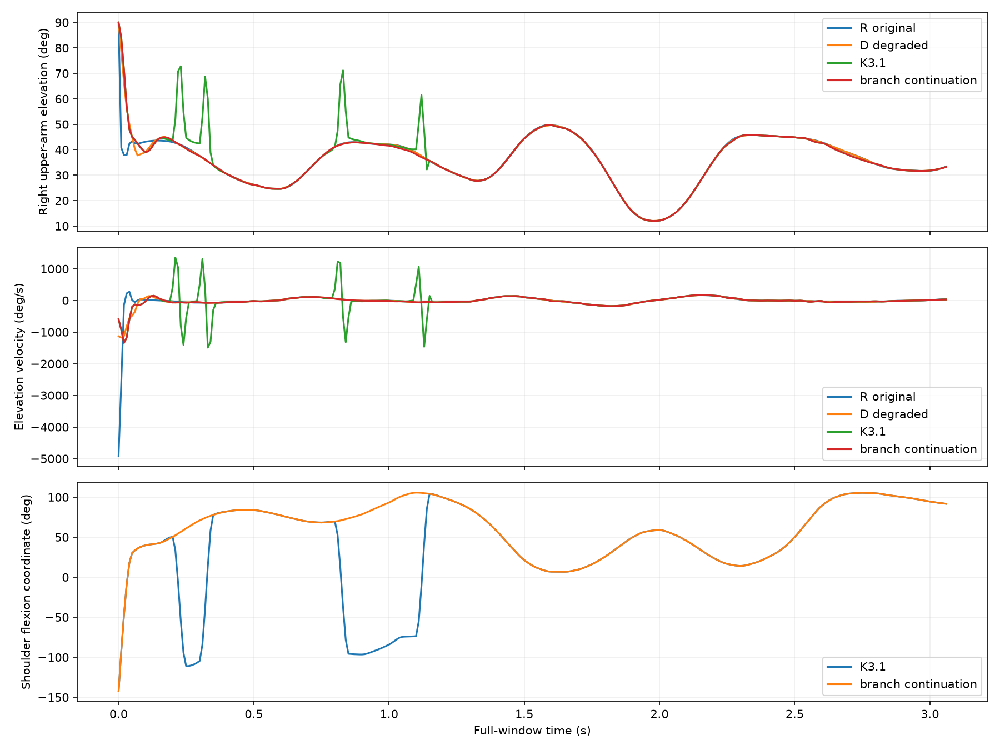

# K3.2 开发阶段：肩部连续性、躯干转换与跪坐约束

本轮延续 K3.1 的端到端验收，以退化前原始动作 R 为参考。先修复已定位的肩部时序问题，再用隔离实验区分躯干转换损失和下肢模型约束。使用已有开发资料，冻结版本及留出使用记录保持原值。

结论：肩部连续性已获得实际改善，作为 K3.2 开发候选保留；躯干的主要偏差位于目标骨架转换；深屈膝动作受到多个模型坐标范围共同限制。后两项已补充归因证据，本轮保持既有转换和正式模型范围。

## 肩部：保持一个已足够贴近输入的连续解

原求解器逐帧比较多组初值，可能在两个都能解释输入的肩部坐标解之间切换。逐坐标 PCHIP 插值会经过不合理的中间姿态。第一轮仅将上一帧解优先作为初值，误差下降但仍留下两处尖峰；第二轮在连续解达到原有目标函数阈值后直接接受，避免为了略小的瞬时残差跳支。

修改只作用于手臂第二阶段，保留关节范围、20 Hz 求解网格和既有插值器。触发与选择都只读取输入和上一帧状态。阈值 0.01 是沿用的加权残差平方和工程阈值，包含方向、位置和弱连续项，不能解释为生物力学精度标准。

Kimodo 擦拭窗口 077，右臂全窗口结果：

|指标|K3.1|仅优先连续初值|接受合格连续解|
|---|---:|---:|---:|
|端到端角度 P95|5.29°|2.11°|1.44°|
|拟合偏差 P95|3.49°|1.44°|1.25°|
|降级损失 P95|0.74°|0.74°|0.74°|
|角速度误差 P95|260.86°/s|89.63°/s|36.16°/s|
|最大单帧角变化|21.21°|15.28°|14.27°|
|输入方向有效覆盖|94.14%|97.07%|99.35%|

角度 P95 为本区域各几何角 P95 的均值；角速度采用区域内全部角速度误差的 P95。覆盖表示相对输入的骨方向误差门限，并非独立原始参考的通过率。每种误差单独统计，三项 P95 不作加减分摊。

曲线中的主要内部尖峰消除，起始瞬变仍保留在全窗口评分中。右腕相对 R 的世界位置 P95 从 17.26 cm 降至 13.84 cm；角度改善并不等于已达到手部空间精度要求。

固定回归包括先前八种格式的典型开发窗口，以及七个已有异常窗口，共 15 个格式—窗口组合、90 个区域。角度、角速度、最大步长、有效覆盖以及原始/统一骨长手脚世界位置均未触发新增恶化门限。CLoSD 两个窗口按既有策略原样复核，其工业左臂 45.30° 尾部误差仍保留。小幅变化与逐区域结果在 acceptance.json 中完整记录。

## 躯干：将重采样、骨架转换、读回分开

每种格式选择已有 82 个开发窗口中躯干降级误差最大的一个，仅作归因。S 是重采样动作，T 是目标骨架转换结果，D 是既有退化读回。以下都是同一原始窗口的倾角误差 P95，不代表全数据平均。

|格式|窗口|S−R|T−S|D−T|D−R|
|---|---|---:|---:|---:|---:|
|ardy|070|0.159°|8.387°|0.000°|8.391°|
|chois|031|0.004°|17.006°|0.000°|17.006°|
|closd|031|0.004°|19.829°|0.000°|19.826°|
|dart|031|0.004°|16.597°|0.000°|16.597°|
|kimodo|010|0.066°|5.021°|0.000°|5.023°|
|motionlcm|031|0.007°|17.007°|0.000°|17.006°|
|omnicontrol|031|0.007°|17.007°|0.000°|17.007°|
|primal|031|0.140°|17.007°|0.112°|17.007°|

转换阶段占据主要误差量级：该阶段按目标静止骨架、节点对应和段旋转重新做前向运动学，内部脊柱及肩部链条的构成改变了骨盆中点到肩中点的方向。统一评价骨长只沿已有方向重建，无法撤销这个已产生的方向变化。当前证据定位到转换阶段；各节点映射、骨段比例、段基底各自的贡献仍需进一步消融。PRIMAL 的重建 T 与历史 D 还有约 0.11° 差异，保留为复现链差异核查项。

## 跪坐左腿：约束耦合，单独扩大膝角不足

Kimodo 刺绣 B 窗口 074 的误差峰值约在 1.00 s。R 与 D 的几何膝屈曲均约 163.81°；模型膝坐标达到 140° 上限，髋内收与踝坐标也达到各自边界。

|完整窗口左腿|K3.1|膝上限改为 175°|同时扩大髋、膝、踝范围|
|---|---:|---:|---:|
|端到端角度 P95|26.21°|27.46°|8.64°|
|拟合偏差 P95|见逐记录结果|27.89°|8.74°|
|降级损失 P95|0.61°|0.61°|0.61°|
|输入方向覆盖|0%|0%|52.92%|

扩大膝范围后，其他方向约束仍使求解器折中，区域误差略升；同时扩大相邻坐标范围才明显改善。由此支持“多个模型约束共同参与误差”的判断。8.64° 的残差和约 53% 的方向覆盖也表明剩余问题仍需处理。扩范围只是诊断条件，未并入候选配置；其肌肉力臂、有效生理范围及距下关节锁定需另行验证。

## 实现、保护与下一步

候选配置位于 `config/evalkit_k32_development_20261116/candidate.json`，K2、K3、K3.1 原配置及默认入口保持原值。模型范围诊断和躯干审计不改变运行策略。HYOID 保持现状。

55 项 K 测试通过；正式两阶段入口与缓存第一阶段的擦拭全窗口实验，坐标和拟合位置最大差异均为 0。旧冻结保护清单 35 项哈希一致，原 config 与 plans 无修改，新增留出运行 0 次。

本轮验证范围为 15 个开发窗口。下一步先对固定 82×8 窗口运行候选策略的完整回归，再决定是否替换 K3.1；躯干转换和下肢模型范围分别立项消融。现阶段的收益支持继续开发，泛化和全范围支持仍由后续验证确定。

复跑：使用现有 OpenSim 环境，设置 `OPENBLAS_NUM_THREADS=1 OMP_NUM_THREADS=1 MKL_NUM_THREADS=1`，运行 `python/scripts/evalkit_k32_continuation.py --out <数据盘的新目录>`；最多两个拟合进程，输入复用原 K3 缓存。实验原始记录和大产物存数据盘；两次阶段源码快照、运行日志保存在 `develop_logs/test_runs/20261116_k32`。正式入口的第一阶段兼容修正发生在第二次实验后，已通过全窗口等价检查；experiments.json 保留每次实验当时的实现哈希。
