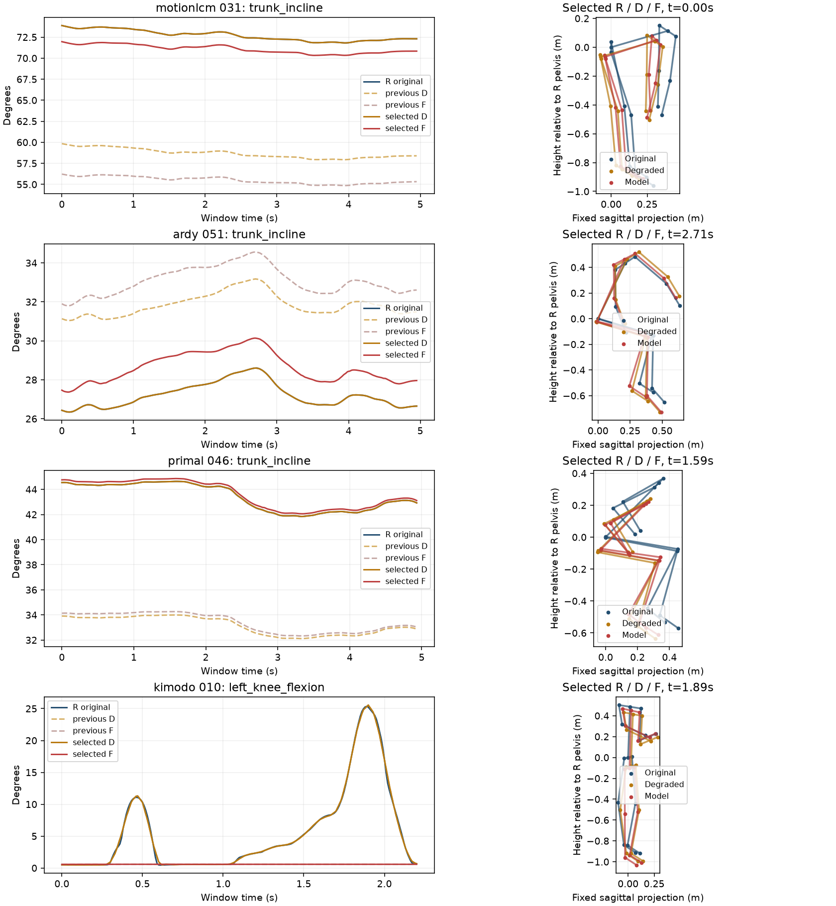

# K3.4：躯干转换修复与逐指标可靠性

本轮针对动画中持续弯腰被拉直、浅屈膝被拟合为伸直、深跪姿受约束三类问题，继续使用固定开发资料，以退化前原动作 R 验收。完成 82 个窗口×八格式的 656 路转换检查、16 个固定窗口的同输入拟合配对（32 次）、两个历史腿部失败窗口诊断及所选配置的完整入口复算。历史冻结和留出使用记录保持原值。

结论：修复了受控退化里的主要躯干方向偏差，端到端收益保留到模型输出；新增逐指标可靠性，保留输入可观测的几何角，同时明确模型重现失败。浅屈膝与深跪姿仍有模型表达限制。新增求解初始化未显示实质精度收益，本轮选择保留原求解策略。

## 躯干：固定目标形状下保持源动作方向

`direction_v3` 以原始骨盆中点至肩中点的方向作为明确的重定向目标，固定目标骨长及骨盆、头胸、四肢的世界朝向，对内部脊柱作最小摆转。骨架 FK、局部／世界旋转及序列化保持一致。

原理：把目标躯干位移分成固定部分 c 与内部脊柱控制的部分 v；沿源躯干单位方向 d，求满足 `|λd−c|=|v|` 的正根，再将 v 最小旋转到 `λd−c`。没有正实根时保留原转换并记录该帧不可行。656 路检查中没有不可行帧。单位测试另行覆盖了不可行情形、反向向量、世界旋转等变性、固定骨长 FK 和头胸端点朝向不变。

按参与者组等权汇总窗口躯干倾角 P95，八格式从约 2.13–6.61°降到 0.039–0.055°。这是明确设计目标在转换端得到实现的证据。受控输入的转换使用源动作是实验定义的一部分；推理端只读取导出的 D，没有访问评分参考。真实基线生成输出的质量需要另行验收。

实际读回后完整窗口结果如下，单位为度，三列分别统计：

|案例|降级 D−R|拟合 F−D|端到端 F−R|原端到端|
|---|---:|---:|---:|---:|
|MotionLCM 031|0.007|1.903|1.900|17.576|
|ARDY 051|0.006|1.811|1.810|6.121|
|PRIMAL 046|0.013|0.245|0.245|10.37|
|Kimodo 010 躯干|0.065|4.995|5.023|5.77|

内部脊柱的调整保留派生属性：各格式摆转中位数约 9.6–14.1°，最大约 48.1°。本轮验证支持整体躯干方向与共同端点的转换；局部椎间角和内部肌肉几何有独立验证要求。源形状与目标形状、可观测段朝向与重定向自由度分别保存，防止把调整后的内部旋转当成独立测量。

## 下肢：修正了“浅夹角必然落在模型能力内”的判断

Kimodo 010 左膝的几何屈曲量约 0–25°，但还涉及膝弯曲平面与脚部方向。新增输入几何初始化、多个内点起始及移除固定变量的同输入配对，仍给出约 22.24°的左膝端到端 P95。这个结果不支持将问题确认为初始化失败。

进一步在 1.90 秒的高误差帧固定输入做模型域消融：

- 保留大小腿及脚部方向目标，官方范围多起点求解选择近 0°膝角，大小腿方向各差约 12.9°。仅扩大髋旋转范围仍得到相同结果。
- 去掉脚部方向目标，官方范围的最佳解仍受限，髋旋转到 −40°边界，膝角约 15.2°，两段方向仍差约 10.6–10.9°。
- 同时去掉脚部方向目标并扩大髋旋转范围，可重现大小腿方向，但需要约 −99.3°髋旋转，超过当前资产范围。

这将问题定位到输入弯曲平面、脚部几何和模型关节自由度之间的兼容性。单帧诊断只支持此帧的机制解释，未将其扩范围结果用于运行配置，也没有据此推断真实人体解剖角。后续若采用其他腿部模型，应同时验收大小腿与脚部，而非只检查无符号膝夹角。

Kimodo 074 的深屈膝继续受膝、髋范围约束；原冻结结果左腿区域端到端约 26.21°、输入方向覆盖 0%。本轮多起点候选仍约 26.22°，没有消除该限制。已有联合扩范围结果保留为模型域诊断。HYOID 和肌肉模型本轮保持现状。

## K 接口：输入观测与模型重现分别交付

新配置保留 `evaluate_body` 对输入直接计算的几何指标。拟合端新增 `metric_quality.npz`，逐指标记录输入角、模型角、误差、输入观测掩码、模型拟合掩码和失败原因。工程阈值继续采用显式的 10°，并保留原始数值供其他精度档解释。

原区域掩码只检查每根骨段方向，两个方向各差 8°时，组合关节角可能已差 16°。新区域掩码同时检查几何角，原方向掩码另存以便追踪。Kimodo 010 左膝输入几何覆盖仍为 100%；模型重现覆盖约 82.81%，原左腿方向覆盖约 92.76%。这项下降修正了支持口径，主误差统计始终使用原完整窗口，误差没有因过滤帧而降低。

完整生产入口复算确认新质量检查前后坐标与端点逐值相同。下游原有注册、位置及力学有效条件继续适用。原配置不启用新门控，历史报告和缓存仍可复现。

## 全身代价、时序与验证范围

16 个固定窗口、96 个区域相对旧 K3.3 完整结果，未触发区域角度 P95 增加 >1°、最大角步长增加 >5°、角速度误差 P95 增加 >10°/s 的告警。Kimodo 008 躯干由约 3.19°到 3.68°的小幅恶化保留在结果中。

姿态改善伴随位置代价。PRIMAL 046 左腕原始世界位置 P95 从 15.74 cm 到 19.51 cm，增加 3.77 cm；右腕增加 3.20 cm。ARDY 051 右腕增加 1.80 cm；DART 031 左足增加 1.32 cm。原始／统一骨长结果均独立保存。共同参考平面上的近地足端速度，左右最大增加约 0.0010／0.0012 m/s；这是几何接触代理，受力验证另行进行。

本轮完成全部 656 路轻量转换，完整拟合覆盖固定的 16 路配对和两个旧失败案例。完整 82×8 的新版模型拟合尚未执行，因此当前配置的精度结论限定于这些开发窗口。下一阶段应先完成该完整回归，再决定是否扩大适用范围；留出集继续保持原使用状态。

## 工程交付与复现

- 所选配置：`config/evalkit_k34_20261117/runtime_config.json`。
- 转换、初始化消融提交：`5ee8c63`。原配置的 solver 路径保留，新种子仅用于开发消融。
- 独立模块：`trunk_transfer.py`、`quality.py`；兼容入口仍为 `load/evaluate/fit`。新配置和实现哈希进入既有缓存键。
- 验收：`config/evalkit_k34_20261117/acceptance.json`，包括完整误差口径、每区域时序、逐指标覆盖、位置和接触代理代价。
- 可复跑实验：在 `5ee8c63` 运行 `python/scripts/evalkit_k34_development.py --light --fit`；汇总入口 `evalkit_k34_summary.py`、`evalkit_k34_acceptance.py`。原输出目录保护哈希一致性，改变实现时需使用独立目录／版本。
- 数据盘：`outputs/evalkit_k34_20261117`；诊断脚本、日志及完整入口复算记录位于 `develop_logs/test_runs/20261117_k34`。
- 66 项 K 测试、16 个子测试及 8 项工效测试通过；217 份既有配置／计划文件和 82 份参考哈希不变，新增留出运行 0 次。运行最多三个工作进程，数值库单线程，保留超过 80 GiB 空间。
