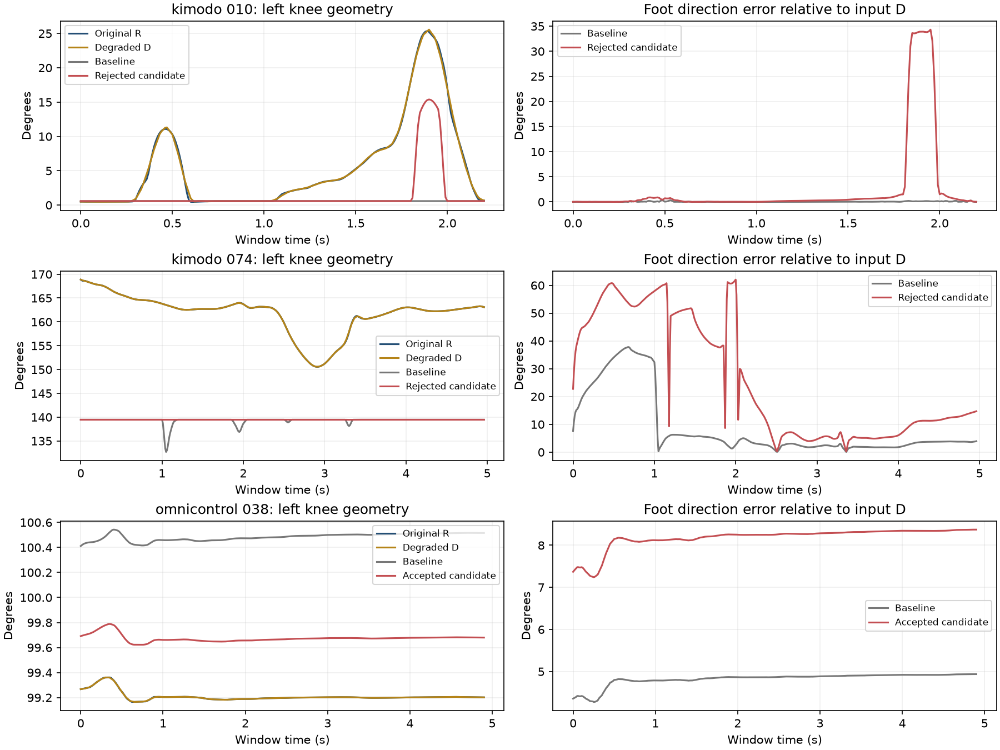

# 同输入屈膝修正：映射核查、分阶段拟合与接受条件

本轮保持八种格式和现有输入字段不变，先核对腿部节点对应，再在同一输入、模型范围与锁定条件下检验“先大小腿、再加入脚部”的拟合。验收继续使用退化前原动作 R，分开保存降级 D−R、拟合 F−D 和端到端 F−R。

结论：分阶段方案在个别典型动作上有有限收益，严重浅屈膝和跪坐问题仍未解决。K 新增显式实验入口和完整窗口接受检查，K3.4 推荐配置保持原值；没有把牺牲脚部后的膝角下降认作整体修复。

## 1. 对应关系核查

Kimodo 源链为 LeftLeg/LeftShin/LeftFoot/LeftToeBase，对应 hip/walker_knee/ankle/mtp 的关节位置；右侧同样保持顺序。ToeEnd 没有进入这条拟合链。本轮未发现左右颠倒、脚趾末端代替根部或骨链顺序错误。

按既有 Y-up 和骨盆侧向轴作中立坐标对齐，源模板相对已缩放模型的方向差：大腿约 0.50°、小腿约 4.45°、足部约 4.32–4.43°。该核查使用源模型缓存的静止几何，并在当前数据盘找到原资产，哈希与登记值一致；历史路径因挂载点名称变化失效，当前解析路径单独记录。

这些数值描述静止几何对应，不等于个体解剖标定。当前没有依据把 4°左右的静态差异直接当作动态 20–30°误差的全部来源，也没有据此对每段动作施加一个常数修正。

## 2. 保持模型域的目标消融

先在 Kimodo 010 和 074 上运行完整窗口，脚部方向残差乘数分别取 1、0.5、0.25，其平方对应最小二乘中的相对权重。三档是本轮预先声明的工程消融选择；位置与连续性权重保持原值。

每帧先以大小腿方向求初始化，再加入脚部方向联合求解。最终模型范围、锁定、输入节点和时钟均保持原值。候选在插值后的完整时钟重新验收。

### Kimodo 010：后段屈膝改善会付出明显脚部代价

|脚部乘数|左膝端到端 P95|足部方向误差 P95 的增加，相对输入 D|足端位置 P95 的增加，相对输入 D|
|---|---:|---:|---:|
|原基准|22.24°|—|—|
|1|22.24°|近零|近零|
|0.5|22.24°|0.29°|近零|
|0.25|12.80°|31.89°|5.29 cm|

0.25 候选主要在约 1.8–2.1 秒弯曲起来，同时出现较大的脚部偏转。它没有满足整条腿的接受条件，正式选择结果回退到基准。该结论区分了局部膝角收益与整体几何代价。

### Kimodo 074：深屈膝范围问题保留

同权重的分阶段求解基本复现基准。降低脚部乘数至 0.5 后，左腿大小腿方向最大误差的 P95 只改善约 1.53°，脚部方向代价增加约 24.43°、足端位置代价增加约 9.68 cm，候选被拒绝。膝坐标仍受到原上限约束。

另外对 Kimodo 010 的既定高误差帧，只解锁模型原有范围内的距下关节作单帧诊断。膝坐标可到约 15°，但距下角到 35°边界，大腿方向仍差约 12.88°。这提供了自由度耦合的证据，尚不足以支持全窗口解锁策略；本轮实验配置保持原锁定。

## 3. 跨格式完整窗口检查

在上述诊断之外，使用预先登记的 11 个窗口组成八格式检查组：Kimodo 010、008、074、077；MotionLCM 031；ARDY 051；PRIMAL 046；CHOIS 000；DART 026；CLoSD 006；OmniControl 038。前九路沿用 K3.4 转换结果，074/077 保留 K3.1 输入及版本标记。

0.5 乘数下，最终输入侧检查在 3 个窗口接受了 4 条腿。接受是基于输入保真和明确的代价界限，并不自动代表对 R 的所有指标改善：

|窗口／部位|膝角端到端 P95，前→后|腿部五项几何角 P95 均值，前→后|解释|
|---|---:|---:|---|
|OmniControl 038 左腿|1.31°→0.48°|1.03°→0.81°|局部及区域均改善|
|OmniControl 038 右腿|1.51°→0.55°|1.04°→0.64°|局部及区域均改善|
|CHOIS 000 左腿|0.67°→0.39°|0.63°→0.66°|膝角改善，区域基本持平略升|
|Kimodo 008 右腿|0.79°→0.34°|1.31°→1.54°|膝角改善伴随足部指标代价|

OmniControl 两侧脚部方向相对 D 的 P95 分别增加约 3.43°、3.69°，仍处于当前工程容差内；足端位置误差反而分别减少约 1.22 cm、1.40 cm。Kimodo 008 的右足倾角端到端由约 0.75°到 2.12°，该局部恶化明确保留。

PRIMAL 046 的候选虽然改善了膝角，但足部方向使输入保真覆盖下降；新增覆盖检查将其拒绝。严重失败案例 010、074、077 均保留基准结果。当前证据支持把方法保留为实验选项，尚不支持替换 K3.4 默认推荐。

## 4. 工程实现与检查口径

`k/legs.py` 管理两阶段求解及接受逻辑；通过 `fitting.leg_refinement.enabled` 接入既有 `fit`，输入读取器与文件格式保持原值。原模型、范围及锁定保留。原始坐标、候选坐标、选择后坐标分别存储，收据保存接受或拒绝的原因。

整条腿按整个窗口接受或回退，避免逐帧切换候选制造接缝。检查同时覆盖：大小腿方向改善至少 1°；膝角 P95 增量不超过 1°；脚部方向增量不超过 5°；足端位置增量不超过 2 cm；膝和所有骨段的最大角步长增量不超过 5°；角速度误差增量不超过 10°/s；输入保真覆盖损失不超过 1 个百分点。10°保真阈值沿用现有工程口径，其他阈值均属于显式开发选择。

接受检查只使用输入 D、基准与候选 F；R 只用于上述独立验收。所有主误差使用原始完整窗口，支持掩码单独报告。最终方案完整入口在 OmniControl 038 复算，与独立实验选出的共同端点逐值相同。其余接受案例完成了实验入口全窗口验证，尚未逐个复算正式入口。

78 项测试及 16 个子测试通过。冻结文件、既有参考和留出记录保持原值；新增留出运行 0 次。大产物位于数据盘，数值库单线程，最多三个工作进程，磁盘剩余约 830 GiB。

## 交付及下一步

- 实验配置：`config/evalkit_k35_20261117/experimental_config.json`。
- 逐指标与区域验收：同目录 `acceptance.json`；映射和完整入口验证：`verification.json`。
- 冻结目标消融提交：`e580516`；原运行产物保留，后续新增时序／覆盖检查在保存的候选上重验，不重复改变求解结果。
- 可复跑：`python/scripts/evalkit_k35_legs.py --out <独立数据盘目录>`；加 `--panel` 运行 11 窗口组。设置三个数值库线程变量为 1。原实验目录拒绝混入不同实现。

下一步应评估与现有观测相容的腿部模型表达，同时独立验收脚部和时间连续性。当前结果已完成映射核查和同模型分阶段求解，明确了单靠改变求解顺序、降低足部权重的收益范围。高误差病例仍需要模型层面的工作，输入要求可以继续保持不变。
