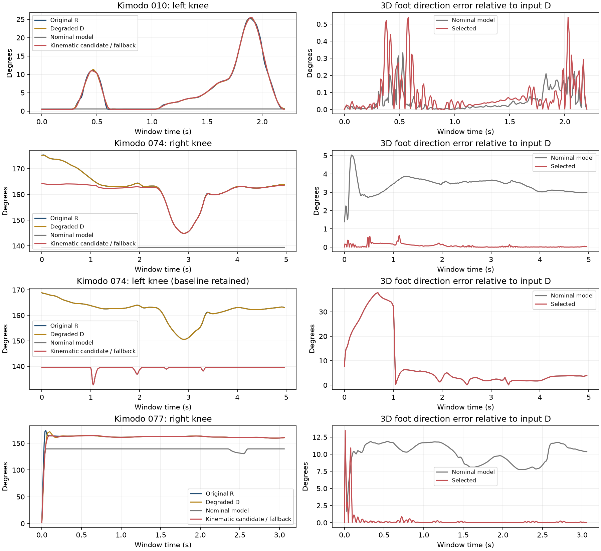

# K3.6：同输入模型域修正与离线连续求解

本轮继续解决屈膝重构，同时保持已有输入字段、八种格式读取器和原始参考不变。先隔离模型范围与自由度，再处理扩展模型中的求解分支切换，最后用退化前原动作 R 验收完整窗口。

结论：在独立的运动学模型副本中，Kimodo 010 和 077 的膝部、脚部重现得到明显改善；074 右腿部分改善，左腿继续回退。模型扩展和连续求解各有作用：原模型加同样连续策略仍未解决三个失败窗口；仅扩展模型则会产生脚部跳变。默认 K3.4 与现有肌肉／受力模型保持原值。

## 1. 模型域与求解器分别做了什么

模型隔离试验在 010、074、077 三个既定窗口上比较四种配置，共 12 次全窗口拟合：仅膝范围、仅髋范围、踝部范围与距下解锁、联合调整。全部使用新复制的模型，源资产、输入节点及骨架几何不变。

联合候选范围为：膝 0–175°，髋屈曲 −90–175°、内收 ±90°、旋转 ±120°，踝 ±90°，距下 ±90°并解锁。这些是开发中的运动学模型域假设，数值与理由在配置和收据里明确记录。其适用证据是关节位置和方向重现；模型坐标的解剖解释、肌肉路径与负荷计算有独立验证要求。

解锁前另处理一个容易混淆的工程问题：旧优化器可能在锁定坐标列中保留名义值，OpenSim 实际忽略它们。新代码先读取模型实际固定值，再解锁，从而保证新模型的基准 FK 与旧输出一致。全部模型域试验均检查该一致性，避免把无效列突然生效当作模型改善。

在 010 左腿，仅扩展膝或髋没有实质改善；扩展踝部后膝端到端 P95 从约 22.24°降至 9.59°，联合调整可降至约 0.61°。但联合候选的脚部方向增量约 19.42°、最大骨段步长增量约 38.75°，因此先被拒绝。

## 2. 伸直附近的可观测性决定了连续策略

010 的脚部异常主要集中在膝接近伸直的帧。大小腿近共线时，位置对膝弯曲平面的约束变弱；不同髋、踝坐标分支可以得到近似位置。分支切换后，对坐标插值可能放大脚部偏转。

先比较上一解延续、加强连续性、100 Hz 逐帧求解三种方案，共 9 次全窗口对照。连续性加强后大部分误差下降，但仍存在单帧跳变，提示初始化位置也重要。

新策略按输入大小腿单位方向叉积的模选择最可观测帧，再从同一帧向前后相邻帧延续。叉积同时在接近 0°和 180°时变小，因此选择依据是膝平面条件，而非简单找屈膝最大的帧。约束不足时保留普通顺序。锚点只来自输入 D；完整参考 R 在验收时才使用。

20 Hz 与 100 Hz 各完成三个失败窗口的对照，共 6 次。20 Hz 配合全时钟检查已消除 010 的新增脚部跳变，膝误差约 0.57°；100 Hz 约 0.57°。所选配置采用 20 Hz，节省求解量，输出与验收继续在原始完整时钟上进行。10°最小平面条件角、0.02 连续性权重等属于显式开发选择。

该方法需要完整动作窗口，属于离线流程；输入文件字段保持原值。未观测的轴向旋转仍依赖模型及连续性先验。

## 3. 原始参考验收：改善及保留失败

下表为膝部几何角的完整窗口 P95，单位为度。降级、拟合与端到端误差分别统计，未用 P95 相减解释贡献。

|案例／侧别|降级 D−R|所选拟合 F−D|所选端到端 F−R|原端到端|区域输入保真覆盖|
|---|---:|---:|---:|---:|---:|
|010 左|0.571|0.201|0.567|22.238|100%|
|010 右|0.345|0.183|0.497|0.597|100%|
|074 左，回退|0.054|28.414|28.398|28.398|0%|
|074 右|0.081|9.827|9.823|34.264|95.98%|
|077 左|1.082|0.164|0.787|16.184|99.02%|
|077 右|2.013|0.681|0.664|28.053|98.37%|

010 左足倾角端到端 P95 从约 0.25°到 0.28°，同时左大腿倾角从约 10.18°到 0.52°。因此该例的膝部改善伴随整条腿方向改善，脚部保持接近原精度。

074 左腿候选仍存在明显骨段跳变；完整窗口接受检查将其回退，其高误差和 0% 支持继续保留。右腿区域五项角误差 P95 均值从约 18.79°降至 4.38°，但膝角仍接近 10°精度档边界。

077 的区域误差均值左侧约 13.49°→1.08°，右侧约 17.41°→3.12°。历史窗口起始边界仍完整计入，未通过删去异常帧获取改善。

## 4. 反事实对照与跨格式检查

最后完成 11 个固定开发窗口的八格式回归，以及三个失败窗口的“原模型＋相同锚点策略”控制，共 14 次全窗口拟合。本轮总计 41 次完整窗口实验，数量包含同窗口不同条件，不能解释成 41 个独立动作。

原模型加锚点策略，在 010、074、077 均没有得到通过接受条件的改善。结合模型扩展但无锚点时出现跳变的结果，当前证据支持模型域与分支连续性共同发挥作用。

八格式 11 个窗口的联合候选在 22 条腿中接受 21 条；074 左腿回退。全部区域主误差继续使用原完整窗口。所选结果没有触发区域角度 P95 增加 >1°、最大角步长增加 >5°或角速度误差 P95 增加 >10°/s 的告警。

位置代价独立保留：PRIMAL 046 左足原始世界位置 P95 约 13.28→15.01 cm，增加 1.73 cm；右足增加约 1.58 cm。OmniControl 038 左右足分别增加约 1.52 cm、1.16 cm。统一骨长结果和接触代理值在逐记录结果中单独保存。这些代价仍限制与场景接触、外力相关的解释范围。

目前验证范围是这组固定开发窗口；完整 82×8 新模型拟合及新留出验证尚未进行。010 等结果的精度结论限于实际检查的输入、窗口及模型配置。



## 5. 独立入口及工程边界

交付 `k/domain_fitting.py::fit_kinematic_domain` 和 `python/scripts/evalkit_k36_fit.py`，沿用现有读取器，先保存名义 K3.4 拟合，再生成独立运动学模型和候选。配置为 `config/evalkit_k36_20261117/kinematic_config.json`。

输出使用 `kinematic_model.osim`、`kinematic_coordinates.mot`、`kinematic_fit.npz` 和独立收据，返回 `output_kind=kinematic_only`、`force_eligible=False`。原模型保存在 `nominal/`，输出目录不提供会被现有受力流程自动识别为新模型的根目录 `model.osim` 或 `coordinates.mot`。默认 `fit`、肌肉模型和 HYOID 保持原值。

在 010 上通过完整入口重跑，与独立实验所选共同端点逐值相同；缓存重放的坐标也逐值相同。新输出验证的是运动学重现，内部关节坐标依赖扩展模型和连续性先验，肌肉及受力资格明确关闭。

复跑示例（使用现有 OpenSim 环境，并设置三个数值库线程变量为 1）：

```bash
/home/heinrich/.local/share/opensim-api/bin/python python/scripts/evalkit_k36_fit.py \
  --input <现有基线输出路径> --method kimodo \
  --out <数据盘独立输出目录>
```

实验入口为 `evalkit_k36_domain.py`、`evalkit_k36_continuity.py`、`evalkit_k36_anchor.py`、`evalkit_k36_panel.py`；各阶段目录保留实现、配置和输入哈希。已完成阶段分别在提交 `07cead9`、`b1f23b7`、`ad14bf3` 可复现。更改实现后应使用新的版本和输出目录。

81 项测试及 16 个子测试通过，包括模型复制保护、锁定变量实际值恢复、锚点可观测性和既有 K／工效回归。225 份既有配置／计划文件、82 份参考以及各实验输入哈希保持不变；新增留出运行 0 次。最多三个工作进程，数值库单线程，大产物保存在数据盘。

下一阶段应先完成新运动学模型域的完整开发回归，继续定位 074 左腿的边界／分支冲突；若要用于负荷分析，再独立验证相应模型的肌肉几何与动力学条件。
