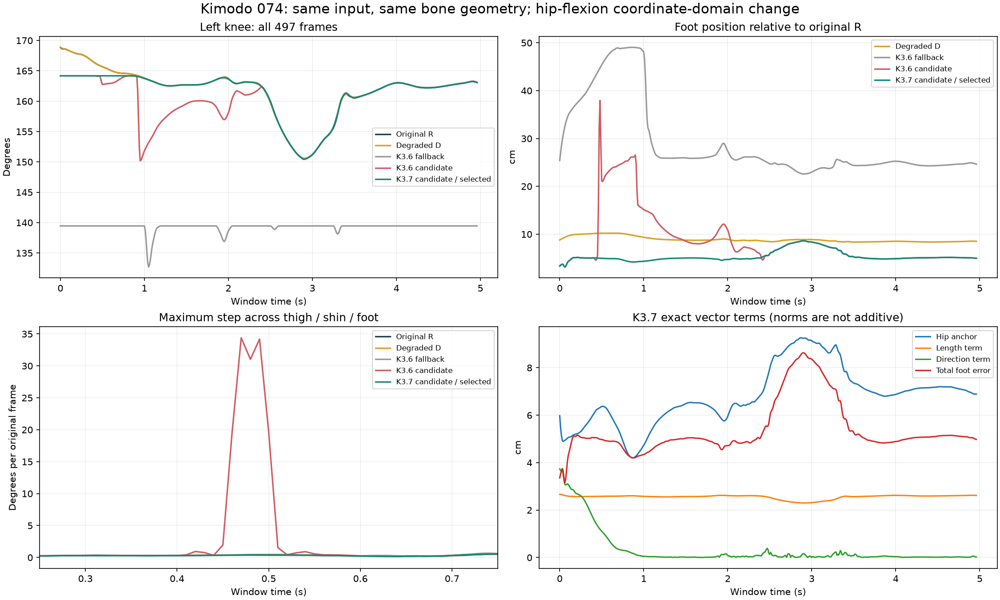

# K3.7：074 左足残差与局部突跳的归因及修正

本轮沿用冻结的 074 Kimodo 开发输入，以退化前原动作 R 验收完整 497 帧。目标是解释左足残差与局部突跳，分别检查骨长、模型约束和求解器，再用独立对照选择修改。候选与最终接受／回退结果分别保存。074、077 使用历史 K3.1 输入；其余九个固定回归窗口沿用 K3.4 修正输入，版本保持原样。

**结论：074 左腿的主要问题是髋屈伸坐标范围截断了连续姿态路径，求解分支切换后，坐标插值产生足部方向突跳。** 仅修改独立运动学模型的髋屈伸范围，即使保留原骨长、膝踝约束、输入、求解目标和采样频率，也能消除该突跳，并将左足端到端位置误差 P95 从旧候选的 24.35 cm 降至 8.22 cm。新候选通过了原有全部接受条件。

## 1. 误差在哪里形成

### 骨长：存在影响，但解释不了主要高误差

旧候选的左足误差 P95 为 24.35 cm；统一评分骨长后仍为 23.55 cm。原参考的大腿／小腿／足段长度中位数为 45.01／41.05／14.58 cm，退化输入为 43.23／42.30／14.17 cm。模型的关节端点距离随关节姿态有小幅变化，不能把所有距离变化都解释为固定骨长缩放。

为了区分来源，逐帧使用精确向量恒等式：

`足端误差 = 髋位置误差 + Σ(拟合段长 − 参考段长) × 参考段方向 + Σ拟合段长 × (拟合段方向 − 参考段方向)`。

旧候选中三个向量项的模长 P95 分别为 9.06、2.62、21.21 cm，显示方向项形成了高误差尾部。它们是逐帧可相加的向量；各项模长及 P95 不可相加，也不解释为贡献百分比。统一骨长评分与这项向量分解采用不同定义，二者分别保留。

### 模型范围与求解分支：0.46–0.47 秒的局部突跳

旧候选最大骨段方向步长为 34.40°，发生在 0.46–0.47 秒的足段。原动作全窗口最大步长为 2.56°，退化输入为 1.90°。

在 0.45 和 0.50 秒两个求解点之间，旧候选髋旋转由约 −81.91° 切换至 +120°，髋屈伸同时碰到 +175° 上界。PCHIP 对这些关节坐标插值，沿途经过了与目标动作相差很大的姿态。旧配置的时间连续性正则与锚点策略已经启用，仍未能维持连续分支。

这些坐标来自原模型的 CustomJoint：左髋屈伸绕 z 轴、内收绕带负号的 x 轴、旋转绕带负号的 y 轴。原文件、坐标顺序、轴方向和局部零位均保持原值。本轮改变的是复制模型上的允许区间。

### 因果对照：固定求解器，只改变范围

先进行髋、踝及联合范围对照，再拆分髋屈伸与髋内外旋。所有对照使用同一输入、20 Hz 求解点、原始 100 Hz 完整评分时钟、锚点与正则设置。

| 范围条件 | 左足端到端 P95 | 左膝端到端 P95 | 全部接受条件 |
|---|---:|---:|---|
| K3.6 旧候选 | 24.35 cm | 6.97° | 足段步长未通过 |
| 仅扩大踝部 | 24.35 cm | 6.97° | 足段步长未通过 |
| 仅扩大髋内外旋 | 19.53 cm | 6.97° | 足段步长未通过 |
| 仅扩大髋屈伸 | **8.22 cm** | **3.51°** | **通过** |
| 同时扩大髋三轴 | 8.22 cm | 3.51° | 通过 |

因此选择最小有效改动：在已有 K3.6 独立运动学模型中，将髋屈伸从 −90..175° 改为 −360..360°，其他范围与锁定保持 K3.6 配置。新求解获得连续的角度表示，原突跳消失。左腿全窗口最大骨段方向步长为 2.03°。

±360° 是用于连续旋转表达的工程区间：它既容纳相差整周的等价坐标，也允许旧区间排除的朝向。它不是解剖活动范围。新增测试验证 −200° 与 +160° 对模型端点产生相同 FK，同时检查原资产和其他坐标范围保持原值。本轮证据支持边界与求解分支共同形成旧突跳；修改后保持原求解器即可通过，因而无需用加强平滑来掩盖该问题。

## 2. 候选、回退与最终结果分别报告

以下均为同一完整窗口对原动作 R 的结果。候选评分没有删除失败帧，也没有使用收紧掩码来制造改善。

| 指标 | K3.6 最终回退 | K3.6 候选 | K3.7 候选＝最终接受 |
|---|---:|---:|---:|
| 左膝角误差 P95 | 28.40° | 6.97° | **3.51°** |
| 左膝角误差中位数 | 23.25° | 0.14° | **0.025°** |
| 左足世界位置误差 P95 | 48.83 cm | 24.35 cm | **8.22 cm** |
| 统一骨长后左足位置误差 P95 | 48.77 cm | 23.55 cm | **8.29 cm** |
| 左腿最大骨段方向步长 | 18.81° | 34.40° | **2.03°** |
| 左腿输入角度保真覆盖（10°门限） | 0/497 | 410/497 | **497/497** |

输入角度保真覆盖只表示腿段方向和几何膝角符合既有输入门限。可评分覆盖为 497/497，另行报告；全覆盖不表示足部世界位置达到厘米精度，也不表示内部关节旋转有独立观测。

新结果的误差链：

| 指标（P95） | 降级 D−R | 拟合 F−D | 端到端 F−R |
|---|---:|---:|---:|
| 左膝几何角 | 0.054° | 3.49° | 3.51° |
| 左足世界位置 | 10.20 cm | 14.42 cm | 8.22 cm |
| 左足去骨盆中心平移后的相对位置 | 1.64 cm | 2.61 cm | 2.81 cm |

世界位置的端到端误差小于拟合偏差，是由于原有退化偏移与拟合根运动偏移部分抵消。它不代表两个环节都准确；三个量保持独立，避免用 8.22 cm 掩盖 14.42 cm 的输入位置偏离。



## 3. 剩余误差及其边界

新候选方向项模长 P95 从 21.21 cm 降至 2.61 cm；髋位置项仍为 9.06 cm，长度项约为 2.62 cm。当前腿部优化固定骨盆，位置尾部已主要转向根运动／髋锚点问题。

在冻结输入中，骨盆中心 D−R 的位置误差 P95 为 8.80 cm，F−D 为 14.43 cm，F−R 为 8.25 cm。F−D 的左右髋间几何差异极小：左髋相对骨盆中心的额外误差 P95 约 0.005 cm。这说明 F−D 的髋位置偏差几乎全来自骨盆中心平移，而不是本轮腿段优化或髋宽变化。上述结果定位了误差发生的层级；本轮未重新调整根运动求解或历史退化转换。

按时间分组，旧候选的明显方向错误位于前约一秒；修正后 1 秒之后的方向项 P95 仅约 0.16 cm。此时足部残差跟随固定髋锚点的误差变化，约 3 秒附近位置误差升高与骨盆位置偏差同步。

开头还保留少量屈膝误差。固定其他姿态，在当前模型允许的 0..175° 膝坐标内按 0.05° 扫描，端点几何膝角最大约 **164.185°**，发生在坐标约 173.65°；原动作开头的端点屈膝角更大。模型关节坐标与由髋—膝—踝端点计算的几何膝角具有不同定义，当前固定几何和关节轴限制了这部分表达。新结果全窗口膝角误差仍全部落在 5° 工程档内；该档位不解释为生物力学标准。

足部接触仍采用关节点代理：新候选左足高度 P05 约高于输入估计平面 3.79 cm。位置／接触及负荷分析须继续保留其适用限制。

## 4. 工程实现与回归

新增 `model_domain.py` 中的 `hip_flexion_chart` 配置，复用已有复制模型、读取、锚点求解、完整窗口接受和回退逻辑。默认 K 拟合和 K3.6 配置保持原值；新版仅通过显式 K3.7 配置启用，仍输出 `kinematic_only` 和 `force_eligible=False`。HYOID、肌肉模型及外力入口保持现状。

```bash
OPENBLAS_NUM_THREADS=1 OMP_NUM_THREADS=1 MKL_NUM_THREADS=1 \
/home/heinrich/.local/share/opensim-api/bin/python python/scripts/evalkit_k36_fit.py \
  --input <基线输出> --method kimodo --out <数据盘独立目录> \
  --config config/evalkit_k37_20261117/kinematic_config.json
```

总计完成 17 次完整窗口对照／回归：六次 074 范围消融和八格式 11 个固定窗口。22 条腿均通过既有接受条件。与 K3.6 已选结果配对，未触发区域角度 P95 增加 >1°、最大角步长增加 >5°、角速度误差 P95 增加 >10°/s 或输入角度覆盖下降 >1 个百分点的告警。074 右腿保持约 9.82°，其余窗口主要指标基本保持原值；K3.6 相对名义模型已有的位置代价继续保留。

82 项测试、16 个子测试通过。独立 API 在 010 上重跑，与实验端点逐值一致，缓存重放一致。新增范围的周期等价测试通过。229 份既有配置／计划文件、82 份原始参考及全部实验输入哈希保持原值；新增留出运行 0 次。大产物在数据盘，保留超过 80 GiB 余量。

配置与结构化验收存于 `config/evalkit_k37_20261117`；原始比较数组、候选、所选坐标和模型存于数据盘 `evalkit_k37_{probe,chart,panel,runtime}_20261117`。本轮范围为固定开发窗口；完整 82×8 新模型回归尚待进行。下一步优先核查根运动平移与原始退化骨盆定位，继续分开检查 D−R、F−D 和 F−R，避免把误差抵消作为优化依据。

六次范围消融的原始运行器保存在提交 `df7344a`，哈希与实验冻结记录一致。后续入口增加了冻结冲突检查：实现或参数变化时先拒绝覆盖既有实验，使用新的 `--out` 路径复跑。该拒绝路径已经验证。四个数据盘实验目录合计约 84 MiB。
