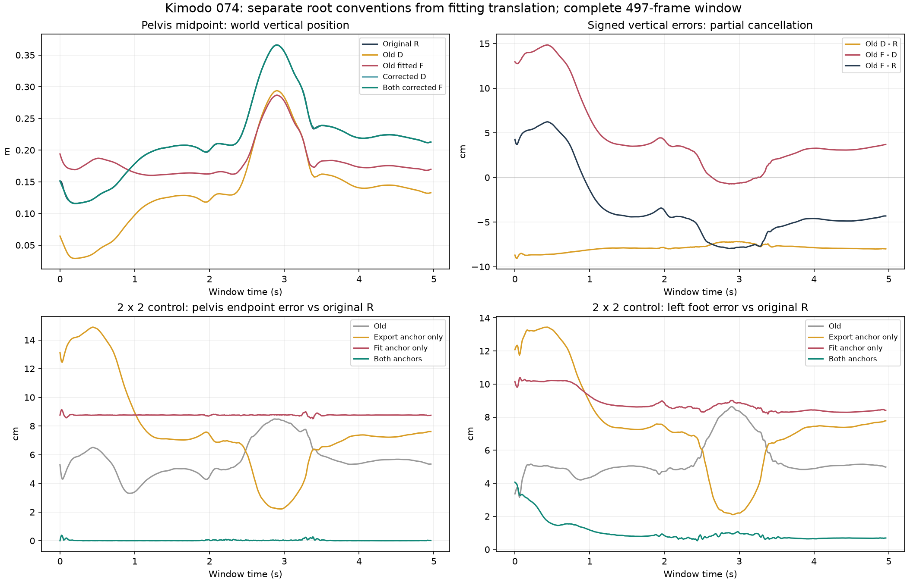

# K3.8：074 骨盆定位、根运动与平移误差抵消

本轮针对 074 左足剩余位置误差，沿用完整 497 帧开发窗口，以退化前原动作 R 验收。先核实源根节点与双髋中点的关系，再追踪初始 IK、方向优化和 K3.7 的根运动，最后做转换／拟合两项修改的交叉对照及完整入口重跑。原冻结输入和结果均保留。

**结论：旧链路存在两项独立平移误差，部分抵消后掩盖了各自的偏差。** 退化转换把语义不同的同名根节点当成相同位置；拟合则继承初始 IK 的根平移，在后续姿态优化后没有重新满足输入的骨盆中心位置。分别修正两项后，完整入口的骨盆中心端到端误差 P95 为 **1.01 mm**，左足为 **2.80 cm**。右足与上身仍有各自的姿态／几何残差，单独保留。

## 1. 来源约定、项目假设与误差发生位置

本报告的“骨盆中心”始终指左右髋关节点的几何中点，不将其等同于人体质心或模型骨盆刚体的原点。

原 BVH 的根节点与双髋中点在本窗口中重合，数值偏差约为浮点舍入量级；Kimodo 目标模板的根节点与双髋中点存在局部几何偏移。旧 `export.retarget` 把目标根的位置设为源根的位置，同时保持目标模板骨架。原世界轴、单位和旋转约定均正确，问题来自项目加入的“同名根节点可直接对应位置”假设。

在 30 Hz 导出时钟上，旧转换根节点的位置误差约为数值零，而双髋中点误差 P95 为 **8.76 cm**，平均偏移约为 x −0.15、y −7.93、z +3.41 cm。重建的旧目标轨迹与本地既有 Kimodo 文件逐值一致，证明该差异已经形成于骨架转换，而非文件读写。回到原 100 Hz 评分时钟后，骨盆中心 D−R 的 P95 为 **8.80 cm**。

拟合端按历史产物追踪如下：

| 阶段 | 骨盆中心 F−D 的 P95 | 相对初始 IK 的根平移坐标变化 P95 |
|---|---:|---:|
| 初始 IK | 19.86 cm | 0 |
| K3 方向优化 | 14.43 cm | 0.041 cm |
| K3.1 | 14.43 cm | 0.041 cm |
| K3.7 | 14.43 cm | 0.041 cm |

该窗口的直立标定有效帧为 0，初始 IK 使用未验证的模型关节中心。初始求解以全身关节点的加权拟合为目标，根平移作为自由变量参与整体折中。后续方向优化调整骨盆朝向等角坐标，但优化变量组没有包含三个根平移坐标，因此几乎原样继承了初始根运动。骨盆刚体原点与双髋中点并不相同，朝向变化会进一步改变双髋中点的位置。代码路径和中间产物共同支持这一归因；本轮没有把全部初始 IK 偏移归因于某一个单独关节。

## 2. 两项修正及信息边界

**转换端：显式保留源双髋中点。** 新增 `root_anchor='hip_midpoint'`，在目标骨架 FK 后施加统一平移，使目标双髋中点匹配源观测。原目标骨长、相对关节点位置、旋转和格式字段保持原值。旧 `source_root` 策略继续保留为默认和历史对照。新策略是项目的几何重定向目标，不能冒充基线自身发布的根定义。

这是受控退化器对原始动作的转换，允许使用生成该退化输入的源动作。导出后，evalkit 只读取普通 Kimodo 字段以及策略标识，不读取原始参考、参考根轨迹或参考修正量。

**拟合端：以输入双髋中点约束根平移。** 在姿态求解结束后，用模型实际的三个平移坐标响应，求解让拟合双髋中点回到输入位置的平移。重新计算模型 FK，验证所有端点仅发生同一平移。角坐标、内部骨架几何及段旋转保持原值。

该过程只使用待评估输入中的双髋观测。缺失或先验髋节点保留原结果并输出无效状态；不可用的模型根自由度也明确记录。输出同时保存修正前坐标、修正前端点、修正量、有效掩码和修正后结果，便于审计。新根约束属于显式几何配置，默认受力和肌肉流水线保持原值。

## 3. 交叉对照：误差抵消不能算作准确

先固定 K3.7 内部姿态，以模型 FK 验证四种平移条件。全程保留同一 R、同一时钟及同一评分窗口，不对参考做平移对齐。

| 条件 | 骨盆 D−R | 骨盆 F−D | 骨盆 F−R | 左足 F−R |
|---|---:|---:|---:|---:|
| 旧转换＋旧拟合根运动 | 8.80 cm | 14.43 cm | 8.25 cm | 8.22 cm |
| 只修转换 | 0.10 cm | 14.43 cm | 14.44 cm | 13.25 cm |
| 只修拟合根平移 | 8.80 cm | 数值零 | 8.80 cm | 10.20 cm |
| 两项同时修正 | **0.10 cm** | **数值零** | **0.10 cm** | **2.80 cm** |

各列为完整窗口的三维位置误差 P95。单项修正后端到端误差可能上升，是因为旧有偏差抵消消失；不能据此保留错误的根定义，也不能把输入保真度的改善直接当作端到端改善。

随后用相同的当前实现，分别对旧输入、新输入运行完整公开入口：名义拟合、K3.7 腿部优化、K3.8 根约束均重新执行，并保存根约束前后结果。完整重跑得到新左足 2.7966 cm、骨盆 1.011 mm；与固定内部姿态对照相比，各端点最大差异约 **0.312 mm**。因此上述收益在实际流程中也成立。

约 1 mm 的骨盆误差验证的是指定几何根目标、重采样与读回精度，不能延伸为真实基线预测或解剖定位具有毫米精度。剩余误差来自 30 Hz 退化和原 100 Hz 评分时钟之间的滤波／插值。



## 4. 完整重跑的误差链、覆盖和残留问题

两项同时修正后的三维位置 P95：

| 端点 | 降级 D−R | 拟合 F−D | 端到端 F−R |
|---|---:|---:|---:|
| 骨盆中心 | 0.10 cm | 数值零 | 0.10 cm |
| 左髋 | 2.08 cm | 0.005 cm | 2.08 cm |
| 左足 | 1.64 cm | 2.61 cm | **2.80 cm** |
| 右足 | 2.96 cm | 7.74 cm | **9.46 cm** |
| 双肩中点 | 3.51 cm | 14.83 cm | **13.05 cm** |
| 左腕 | 7.19 cm | 14.66 cm | 10.57 cm |
| 右腕 | 5.38 cm | 15.14 cm | 11.35 cm |

这些范数／分位数不相加。左足统一骨长后的端到端 P95 为 2.61 cm，说明此时进一步误差仍须区分几何与姿态。左膝角 P95 保持 3.51°，原有局部突跳修复得以保留。

与 K3.7 对比，右足从 9.14 cm 变为 9.46 cm，双肩中点从 12.23 cm 变为 13.05 cm。它们说明根定位修正并不自动解决上身与右腿的相对几何偏差；报告明确保留这些代价。

可评分覆盖保持 497/497。输入角度保真覆盖为左腿 497/497、右腿 477/497；以输入位置误差不超过 10 cm 的既有门限计算，双腿均为 497/497，而躯干约 54.5%、左右臂约 52.1%／58.8%。输入保真覆盖与对 R 的准确度分别报告。

骨盆速度相对 R 的误差 P95 从 0.237 m/s 降至 0.0456 m/s；新拟合 F−D 的速度误差为数值零，剩余速度误差与退化时钟一致。未为提升结果裁剪首尾帧或调整时间对应。

实验还保留了足部高度、速度和接触代理值。四条件使用同一个由原动作足点 P05 得到的比较平面，该平面仅参与评分；通用 `scoring.py` 继承的 contact 描述文字不能作为该平面的来源说明。结构化验收文件已明确记录本轮平面口径，避免借由改变平面隐藏根偏差。受力资格保持关闭。

## 5. 跨格式检查及采用范围

对八格式、11 个既有固定窗口执行了仅修拟合根平移的检查。所有有限输入的骨盆 F−D 均降为数值零，几何角度不变，但旧输入的转换偏移仍在。例如 DART 026 左足端到端 P95 从 4.55 cm 升至 8.23 cm，MotionLCM 031 从 11.91 cm 升至 14.19 cm。逐端点的改善和恶化均写入验收文件。

因此本轮将新根约束作为显式可选能力，并在 074 上完成“转换与拟合配套修正”的验收。其余格式尚未完成根定义配套转换的全量验证；不能将这 11 个旧输入的根保真检查称为全身端到端回归通过。默认配置与历史输入均保持原值。真实基线输出应按其实际世界关节点位置处理，不能利用本受控实验的参考平移去修正真实预测。

## 6. 交付和开发纪律

代码集中在 `k/root_alignment.py`，由 `export.retarget` 和独立 `domain_fitting` 接入；复用既有 FK、评分和版本缓存。K3.8 配置位于 `config/evalkit_k38_20261117`，提供转换策略与运行策略的独立记录。输出继续使用 `kinematic_*` 文件名，附带 `force_eligible=False`。HYOID 保持原值。

运行入口：

```bash
OPENBLAS_NUM_THREADS=1 OMP_NUM_THREADS=1 MKL_NUM_THREADS=1 \
/home/heinrich/.local/share/opensim-api/bin/python python/scripts/evalkit_k36_fit.py \
  --input <输入路径> --method kimodo --out <数据盘新目录> \
  --config config/evalkit_k38_20261117/kinematic_config.json
```

转换端通过 `retarget(reference, 'kimodo', policy='legacy', root_anchor='hip_midpoint')` 复现本轮 074 实验；这里保留 `legacy` 的历史躯干转换，只隔离根定位因素，不同时引入其他版本变化。

84 项测试及 16 个子测试通过，包括不同骨盆朝向下的刚体平移、角坐标不变、缺测／先验髋节点处理及既有 K／工效回归。两份输入的完整公开入口均通过缓存重放检查。

233 份既有配置／计划文件、82 份原始参考和 77 份实验输入／K3.7 结果文件的哈希保持原值，其中包含历史留出使用记录；新增留出运行 0 次。大产物约 65 MiB，保存在数据盘的 `evalkit_k38_root_20261117`、`evalkit_k38_runtime_20261117`；最大三个工作进程、单进程数值库单线程，磁盘余量约 830 GiB。仓库提交紧凑统计与完整结果哈希，完整逐帧数组保留在数据盘。

下一阶段应把这次发现的根语义对应扩展核查到其他格式，再执行配套转换与拟合的固定开发回归；074 则继续关注右腿和上身相对骨盆的几何误差。完整 82×8 新版回归尚未执行。
