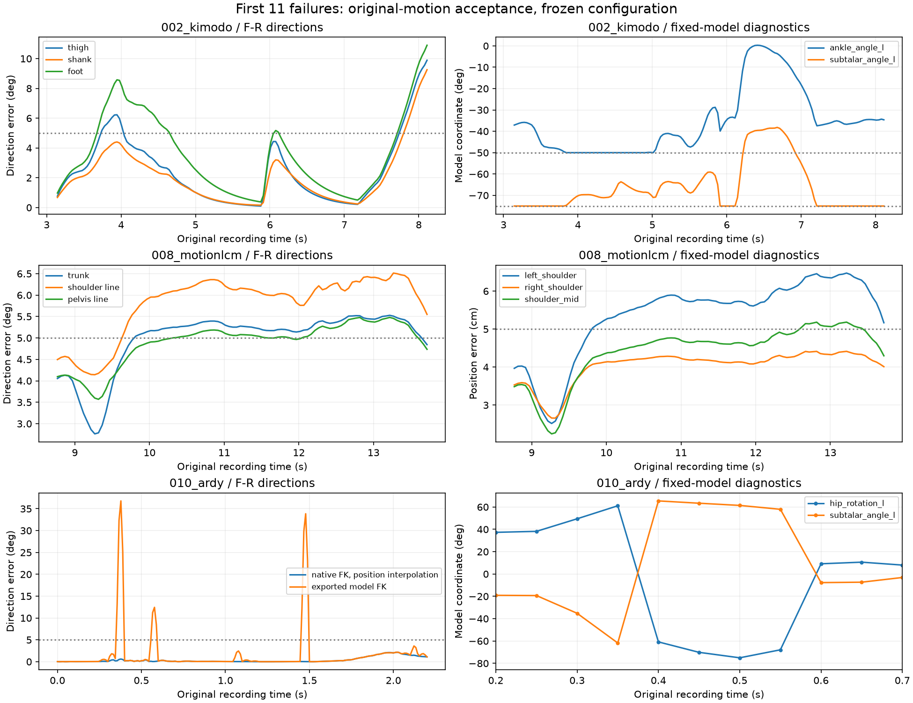

# K4 首批 11 路未通过：动作、超标部位与原因核查

本报告固定分析用户确认的11路：002的八种格式、008的MotionLCM/OmniControl、010的ARDy。截取时共85路完成；后台继续运行，因此本报告的11路名单与动态总数分开。11路均为计算完成后未满足验收条件，执行与覆盖检查通过。原动作R只用于本次独立诊断；拟合、选择、评分规则及656路任务保持冻结。

结论：11路来自3个原动作窗口。002主要是左腿姿态与变化率误差，足踝范围边界是明确排查线索；008主要是固定躯干几何与姿态目标之间的持续折中；010包含原生左腿时序误差，以及关节坐标分支变化在帧间插值中放大的足部异常。全部可直接定位到K拟合或输出链，当前证据不支持用退化损失解释这些超标。

## 动作与超标阶段

| 原动作窗口 | 来源与动作类型 | 分析窗口（原记录时间） | 主要问题阶段 |
|---|---|---|---|
| 002，8路 | CoLLaboratE飞机铆接；屈膝、左右腿不对称，躯干前倾后回正 | 3.144–8.144 s | Kimodo代表：约3.68–4.64 s足部方向超标；7.74–8.11 s末段左大腿、小腿、足方向共同恶化 |
| 008，2路 | 玻璃吹制作业的Beak cutting / Trimming（修边）；持续前倾 | 8.761–13.761 s | 约9.67 s后肩线持续超标，9.82 s后躯干持续超标；原动作躯干倾角中位数约52.85° |
| 010，1路 | 玻璃吹制作业的Blowing and shaping / Body blowing；近直立，后段出现屈膝与前倾 | 0–2.233 s | 原生左腿变化率未通过；0.35–0.40 s等帧间区间出现额外足部偏离 |

作业类型来自固定名单的原记录路径；姿态阶段来自原始参考坐标，不由拟合输出反推。002只有几何证据支持左右腿不对称，场景中的实际支撑物仍需视频确认。

## 逐路指标

以下表格采用原生FK、D采样时钟、完整连续层F−R的P95。角度单位°，位置单位cm，变化率单位°/s；三组窗口均无冻结来源跳变帧，因此连续层与完整窗口的帧级指标一致。角度/位置目标为5°/5cm。变化率是骨段单位方向向量导数差，不是解剖关节角速度；验收门槛为相对D−R的P95增加≤10°/s。

| 格式—窗口 | 左大腿方向 | 左小腿方向 | 左足方向 | 左膝位置 | 左膝屈曲角 | 左大腿/小腿/足变化率 |
|---|---:|---:|---:|---:|---:|---|
| 002_ardy | 6.40 | 5.78 | 8.65 | 5.53 | 1.06 | 15.40 / 14.78 / 17.55 |
| 002_chois | 6.78 | 5.92 | 8.44 | 5.86 | 1.26 | 15.67 / 14.11 / 17.35 |
| 002_closd | 6.78 | 5.92 | 8.44 | 5.86 | 1.26 | 15.67 / 14.11 / 17.35 |
| 002_dart | 6.78 | 5.92 | 8.44 | 5.86 | 1.26 | 15.67 / 14.11 / 17.35 |
| 002_kimodo | 6.78 | 5.92 | 8.44 | 5.86 | 1.26 | 15.67 / 14.11 / 17.35 |
| 002_motionlcm | 6.63 | 6.16 | 7.74 | 5.58 | 1.62 | 14.92 / 17.14 / 17.93 |
| 002_omnicontrol | 6.47 | 5.50 | 7.58 | 5.46 | 1.61 | 14.94 / 17.13 / 18.01 |
| 002_primal | 6.83 | 5.97 | 8.48 | 5.90 | 1.29 | 15.69 / 14.14 / 17.39 |

| 格式—窗口 | 躯干方向 | 肩线方向 | 骨盆线方向 | 左肩位置 | 时序 |
|---|---:|---:|---:|---:|---|
| 008_motionlcm | 5.51 | 6.42 | 5.45 | 6.43 | 通过 |
| 008_omnicontrol | 5.51 | 6.42 | 5.45 | 6.43 | 通过 |

| 格式—窗口 | 原生D时钟姿态 | 原生D时钟变化率 | 导出R时钟足方向 | 导出R时钟足最大步长 | 导出R时钟足变化率 |
|---|---|---|---:|---:|---:|
| 010_ardy | 全部必需角度/位置通过；左大腿3.98°、小腿4.20°、左膝位置3.09cm | 左大腿19.83、小腿21.22，未通过 | 8.74° | 25.70° | 788.63°/s |

补充边界：002_omnicontrol在R时钟上肩线P95为5.003°，属于另一个临界超标。010的导出R时钟同时有左大腿30.99→31.63、左小腿37.84°/s的时序问题，全部详情保留在JSON。各时钟分别验收，表格不互换分母。

## 原因与证据强度

### 002：足踝约束相关的左腿整体偏离，伴随变化率误差

八种格式重复出现左腿同一组问题，指向公共拟合路径。左膝屈曲角P95只有1.06–1.62°，而左膝位置为5.46–5.90cm，说明屈膝量基本重现，但腿段在空间中的方向与膝位置偏了。左踝和足端位置仍达标，末端位置达标与足方向达标是不同指标。

Kimodo中，左踝坐标34/150帧贴近−50°边界，距下坐标56/150帧贴近−75°边界。足方向超过5°的44帧全部发生在二者至少一个触边的帧上。这里“距下”指踝下的模型关节坐标，不等同于足部三维朝向。当前姿态分配在范围边界附近出现残差，是强排查线索；尚未做固定几何下的可达性对照，因而不能据此声称唯一原因或必须扩大范围。

统一骨长后，Kimodo左膝位置P95为5.84cm，原始几何为5.86cm；全部八路归一后仍为5.45–5.89cm。纯骨长尺度解释不了主要残差。髋、膝坐标未触及当前范围，左膝也没有深屈曲限位问题。名义初值与连续初值均有正常终止记录，但正常终止只表示求解器停止，不证明全局最优或模型不可达。两个整段候选都未通过，默认选择只是当前输入质量排序中较优的一项。

时序问题主要是方向变化率误差；最大单步方向增量均通过。代表性轨迹显示随动作阶段增长的偏差，应与孤立突跳分开处理。原生FK和导出在D节点上数值一致，R时钟上主姿态偏差也基本保持，因此导出不是这八路共同失败的主要来源。

### 008：位置输入分支的固定几何先验与姿态目标折中

两个位置格式的实际拟合躯干中立长度约53.89cm；同一动作六种有声明骨架的分支为49.00cm。位置分支回执明确记录：中立长度未识别，使用模型先验。这是K对信息不足的处理策略，不能把该先验造成的拟合偏差归为退化转换损失。

在持续弯腰中，过长的固定躯干几何与观测肩位置/躯干方向难以同时匹配。选中候选相对另一个候选，把肩线P95从9.35°降至6.42°、左肩从6.90cm降至6.43cm，同时骨盆线从1.94°增至5.45°，体现了目标之间的折中。腰椎坐标未触边，时序检查全通过，偏差持续覆盖大部分窗口。

同一原动作六个带声明骨架分支全部通过，支持“固定几何与配置路径相关”的判断；它们也存在格式/目标等差异，尚不足以将全部误差因果量化为单一长度因素。统一骨长评分把左肩P95从6.43cm变为5.005cm，方向误差仍存在；两种P95的差不能解释为长度贡献百分比。

### 010：原生分支不连续，被独立关节插值放大

原生D采样点上的必需角度和位置全部通过，但左大腿/小腿变化率P95为19.83/21.22°/s，已超过本轮门槛。这是原生拟合的时序问题。

0.35–0.40s，左髋旋转坐标从61.09°变到−60.81°，距下坐标从−61.77°变到65.45°。两个关节反向变化，使采样点上的足方向仍接近原动作，但帧间关节分别插值时，这种抵消关系没有持续保持。当前髋已采用SO(3)插值，单自由度距下坐标采用标量插值；独立关节的旋转插值正确不保证整个肢体的末端轨迹连续可信。

实际导出在原动作时钟上足方向P95为8.74°，峰值36.79°（0.37778s），单步25.70°，变化率P95为788.63°/s。用原生FK端点位置插值得到的诊断轨迹，足方向P95为1.86°、峰值2.16°；这一对照用于定位帧间输出影响，不是替代模型FK的合格输出。D−R在R时钟上也有有限采样导致的变化率差异，冻结验收已以其为控制项，以上导出异常仍明显超出门槛。

导出在原生节点上的位置差小于1e−15m，实际MOT回读FK误差约1.8e−15m；文件精度和回读不足以解释异常。原生坐标分支选择与帧间插值共同构成问题，应分别验收。近伸直膝使腿段方向对轴向转动的约束变弱，是解释这种分支变化的几何假设，后续需通过输入可观测性与分支对照确认。

## 三类误差、覆盖及本轮边界

在本次超标项对应的原生D时钟上，D−R接近数值精度，F−D与F−R基本相同。例如002_Kimodo左膝位置约0 / 5.86 / 5.86cm；008_MotionLCM左肩约0 / 6.43 / 6.43cm；010_ARDy足方向约0 / 1.71 / 1.71°。端到端验收继续使用R；这些数据支持将本次主要残差定位在K链内。

11路全窗口可观测覆盖检查全部通过；位置格式欠观测的头胸相对轴向旋转继续保持不可评价，覆盖通过不授予缺失指标资格。头颈可观测指标、手腕及右侧膝足没有成为这11路的阻塞项。原动作时钟末端超出D时间范围的帧继续按冻结边界单独登记，不删除分母、不扩大掩码。

本次只读取原有产物并计算诊断轨迹，没有运行新拟合、修改参数或替换结果。610份历史保护文件及冻结实现哈希复核一致。后台控制器继续按8worker上限、数值库单线程执行。后续优化优先级：010跨关节分支连续性与导出；002足踝范围和固定几何可达性；008输入可辨识的几何策略及目标折中。正式优化应另开版本，与本轮完整冻结结果配对。

[逐路失败、候选与来源哈希](../test_runs/20261118_k4_first11/failure_details.json) · [完整诊断指标](../test_runs/20261118_k4_first11/analysis.json) · [复跑脚本](../test_runs/20261118_k4_first11/analyze.py) · [冻结核验](../test_runs/20261118_k4_first11/preservation_check.json)

