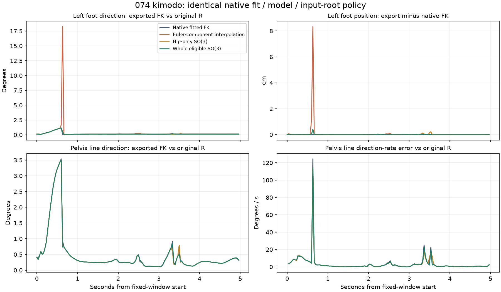

# K4 全身旋转插值核查与误差归因（2026-11-18）

本轮要检验的是：在同一份原生拟合姿态、固定模型和输入 root 策略下，旋转插值是否制造了额外运动；修改以后，相对退化前原动作的误差如何变化。

**全身适用关节已接入 SO(3) 插值，074 的左足插值突跳得到修复。原生拟合的骨盆偏差仍存在；070 的原生手臂跳变及受约束插值／导出回读增量仍需处理。整体 K 的达标资格保持待验收。** 本轮没有重新优化求解器，也没有把插值修复记作求解器改善。

## 核查范围与实际修改

已核查冻结的 656 路 common_v1 模型及原生坐标，八种格式各 82 路，656/656 成功，覆盖每份模型的全部 22 个关节。另对固定 20 组合做数值重放，并按全量审计中的非髋坐标最大步长追加四条开发诊断：053 ARDy（骨盆）、074 OmniControl（腰背）、001 ARDy（左肩）、070 CHOIS（右肩）。这四条依据拟合原生坐标选取，名单先登记，R 误差不参与选择；原 20 名单保持原值。

| 部位／链 | 核查后的处理 | 依据与边界 |
|---|---|---|
| 骨盆、双髋、腰背、双肩，共 6 个三轴关节 | 局部关节旋转 SO(3) 最短弧插值；再求符合模型范围的等价欧拉表示 | 从实际模型读取轴顺序、符号和坐标范围；每个原生帧与 OpenSim 父／子关节坐标架核对 |
| 踝、肘、前臂旋前等单轴关节 | 沿声明单轴坐标插值 | 本轮数据中相邻增量均小于 180°，与该单轴旋转子群的最短弧等价 |
| 双膝及双侧髌股关节，共 4 个耦合关节 | 插值主坐标，重新计算从属坐标，再执行 FK | 保留旋转与平移耦合曲线；自由旋转插值会改变关节的允许运动 |
| 锁定关节 | 保留固定状态 | 656 份原模型各有 6 个锁定关节；本轮六份独立运动学候选解锁了双侧距下，因而是 4 个锁定、8 个单轴关节 |
| 头颈链 | 保留已有的有效掩码约束 SLERP 与链 FK | 先插值声明的世界段旋转，再通过矩阵乘积构成链局部旋转；位置输入的轴向转动仍保持未知 |
| root 平移 | 独立的位置插值与输入双髋中点补偿 | 每组使用同一规则，保留补偿前后坐标和 FK；本轮没有采用 SE(3) 插值 |

实现集中在 `utils/motiogen/evalkit/k/resampling/`，通过 `rotation_resampling="whole_body_so3"` 显式启用。缓存哈希递归包含子路径源码。头颈、短缺测恢复和运动导出中已有的 SLERP 路径也已核查。旧兼容入口的逐坐标低通／三次插值保留历史语义；本轮 K4 配置选择 `native_preserving`，避开该旧路径。

SO(3) 的计算对象是旋转矩阵：`R(t)=R0 Exp(α Log(R0ᵀ R1))`。欧拉坐标只作为模型的最终参数表示。实现同时处理两个等价欧拉分支、2π 表示和万向节锁点的连续等价解，并用矩阵重建验证。SLERP 选择帧间最短旋转路径；对采样间发生的额外转动和角速度连续性，仍需独立证据。

最短路径超出模型坐标域时，整个原生间隔回退为受约束坐标插值，保留帧和评分分母。检查覆盖输出采样、原生结点和间隔中点，证据范围是这些采样点。固定面板有 **52/16,044 个三轴关节间隔回退**：069 Kimodo 左肩 51 个、074 Kimodo 左肩 1 个；补充面板有 **5/2,382 个间隔回退**。回退原因及原生 FK 一致性误差逐项留档，范围没有在插值阶段被悄悄放宽。

## 实验怎样分开三种影响

每组共享同一份原生坐标和模型，重放原生帧 FK、逐欧拉角插值、旧髋 SO(3)、全身适用关节 SO(3) 四种条件。原 20 组合包含六份 v6 rotation_only 原生拟合和十四份 common_v1 原生 IK；后者用于覆盖八种格式的插值兼容性。所有比较都在同一记录、同一源拟合内配对，十四份旧拟合的数值保留其旧版本身份。

运行端只读 D、声明骨架、既有模型和拟合坐标；评分端独立读取 R。旧模型没有头颈附件定义时，在原生 D 时钟上标定一次固定附件，并由四组共同使用。它属于本轮重放的组合模型定义，区别于旧 common_v1 完整输出。

- **D−R**：冻结输入与原动作的对照，保持原验收记录。
- **F−D、F−R**：每种输出各自重新 FK 后，相对输入及原动作评分。
- **N−R**：N 是原生 D 时间戳上的拟合模型 FK，用于观察插值前已有的姿态偏差与跳变。
- **E−N**：E 是导出后的 FK，按原评分器读回 D 时间戳。它包括插值路径、导出采样和位置读回产生的增量，不能单独命名成“求解误差”。

位置向量满足 `E−R=(N−R)+(E−N)`；原始／统一骨长两套几何均检查，固定面板最大闭合残差为 `5.56e−17 m`。范数、P95 与旋转距离各自统计。共同骨长只进入评分端。原动作原始采样时钟也单独评分，防止输出采样恰好落在原生结点而漏看帧间差异。来源跳变分层沿用冻结定义，K 引入的偏差保持在验收内。

## 074：左足插值错误修复，骨盆原生偏差保留

下表采用固定连续窗口。方向步长是相邻输出方向的变化；变化率误差是相对原动作的单位方向向量导数误差，区别于解剖关节角速度。

| 条件 | 左足最大方向步长 | 骨盆方向变化率误差 P95 | 相对 N 的最大位置增量（全身节点） |
|---|---:|---:|---:|
| 原生拟合 FK | 1.892° | 10.817°/s | 0 |
| 逐欧拉角插值 | 18.478° | 11.325°/s | 8.333 cm |
| 仅髋 SO(3) | 1.905° | 11.325°/s | 0.723 cm |
| 全身适用 SO(3) | 1.905° | 10.882°/s | 0.422 cm |

左髋在一个原生间隔中，逐欧拉角插值比端点最短旋转多走了约 **299.94°**；SO(3) 消除了这条错误路径。因此左足 18.48° 的额外突跳可以归于插值。骨盆的 10.82°/s 在插值前已有，SO(3) 对它的影响很小，后续应在原生拟合层继续检查。

全身 SO(3) 下，该窗口端到端左／右膝角 P95 为 **1.451°／0.362°**，最差节点位置 P95 为 **2.533 cm**，角度、位置及覆盖达到对应目标；骨盆变化率仍超过输入对照的 10°/s 门槛。以下同时给出输入与端到端，保留口径：

| 指标 P95 | D−R | F−D | F−R |
|---|---:|---:|---:|
| 躯干方向 | 0.01882° | 0.74874° | 0.73279° |
| 肩线方向 | 0.00977° | 1.38751° | 1.38499° |
| 骨盆髋连线方向 | 约数值零 | 2.18111° | 2.18111° |
| 左小腿方向 | 约数值零 | 2.16677° | 2.16677° |
| 左足方向 | 约数值零 | 0.58878° | 0.58878° |
| 左踝世界位置 | 约数值零 | 2.53252 cm | 2.53252 cm |

图中右上角显示插值／导出回读相对原生 FK 的位置增量；其余面板对照 R。曲线的峰值与表中的 P95／最大步长是不同统计量。SVG 与 PNG 均可离线读取。

## 肩部压力检查与剩余限制

053 ARDy 中，逐欧拉角插值在右／左肩分别多走约 14.82°／13.18°；SO(3) 将对应路径绕行消除。这说明适用范围已覆盖髋部以外的真实开发记录。单元测试还独立验证了肩部欧拉表示切换而真实旋转不变的案例。

001 ARDy 左肩与 070 CHOIS 右肩的最短旋转路径遇到旧模型范围约束，保持回退；它们对应的最大路径绕行为约 28.78°／62.65°。这是固定模型允许路径与最短旋转路径的差异。本轮保持模型不变，后续可以在已授权的独立运动学范围配置中单独验证，避免混入插值对照。

070 CHOIS 的连续窗口中，输入右上臂最大方向步长 **2.66°**，原生模型输出已有 **33.74°**；这项问题在插值前形成。原生右上臂／前臂方向变化率误差 P95 为 **80.99／64.63°/s**，全身 SO(3) 导出回读后为 **98.01／82.12°/s**，仍有超出 10°/s 的新增增量。该记录同时保留原生拟合问题和受约束插值／采样回读问题；单独采用 SO(3) 无法完成其时序验收。后续应把原生模型约束／求解分支与导出时钟分别对照。

074 OmniControl 的旧“仅髋 SO(3)”对照因规范欧拉表示越出旧范围而失败。全身版本通过等价表示搜索及明确回退完成重放；旧对照失败保留在分母中。

## 面板验收与完整分母

固定 20 组合四条件全部完成，80/80 份评分；补充四组合的三项主要条件全部完成，旧髋对照完成 3/4，合计 **95/96** 份计划评分。95 份保存输出全部逐帧重新执行 OpenSim 身体 FK 和从属坐标同步检查，通过 95/95；缺少的一份就是上述旧对照失败。

固定面板全身 SO(3) 相比逐欧拉角插值，连续窗口逐指标最大 P95 退步为 **0.000163°／0.010664 cm**；在 R 原始时钟上为 **0.000288°／0.003322 cm**。补充面板 R 原始时钟上最大退步为 **0.008341°／0.014494 cm**。观测覆盖没有下降。小幅 P95 变化与 070 的局部时序阻塞同时保留，不能用前者覆盖后者。

完整 K 仍按原冻结验收规则评价：固定面板全身 SO(3) 为 **3/20 通过**，四条补充记录为 **0/4 通过**。其中六份 v6 拟合的当前状态如下；其余十四份旧 common_v1 的旧拟合误差另表登记。

| v6 原生拟合记录 | 全身 SO(3) 后状态 | 当前阻塞 |
|---|---|---|
| 000 Kimodo | 通过 | — |
| 015 Kimodo | 未通过 | 躯干 6.79°，肩线 17.38°，左上臂 23.16°；双肩位置约 8.27／7.87 cm |
| 017 CHOIS | 未通过 | 骨盆髋连线方向 6.16° |
| 022 Kimodo | 通过 | — |
| 069 Kimodo | 通过 | 左肩域回退仍有记录，当前目标／覆盖／时序通过 |
| 074 Kimodo | 未通过 | 骨盆变化率误差 10.88°/s |

本轮完成了全身插值方法的接入和配对核查；656 路全量重新拟合与最终 K 达标仍属于后续验收。显式全身插值配置保留为开发候选，默认配置保持原值。下一步重点：074 的原生骨盆分支、015／017 的原生姿态残差，以及高跳变窗口在固定导出时钟上的增量；继续分别对照输入和 R。

## 复现、测试及保存

- 核心实现提交：`c9ffd3d`。固定面板运行代码可由 `85a11af` 恢复；补充面板 v2 增加了旧对照失败独立记录，SO(3) 数值算法保持同一版本。
- 配置：`config/evalkit_k4_20261118/rotation_v1/fit.json`；固定面板协议 `rotation_v2/protocol.json`；补充协议 `rotation_stress_v2/protocol.json`。协议中保存逐记录输入、模型及原生坐标哈希。
- 入口：`python/scripts/evalkit_k4_rotation_audit.py`、`evalkit_k4_rotation_batch.py`、`evalkit_k4_rotation_probe.py`、`evalkit_k4_rotation_review.py`、`evalkit_k4_rotation_figure.py`。重放前核对协议源码哈希；重跑使用新输出目录，既有目录禁止覆盖。历史协议应在其对应源码版本执行。
- 数据盘根：`/media/heinrich/9bbdd73e-4410-4279-9639-6161f0c958391/MorionGen/outputs/evalkit_k4_20261117/`。全量审计 `whole_rotation_audit_20261118_v1.json`；固定面板 `whole_rotation_20261118_v2/review_final.json`；补充面板 `whole_rotation_20261118_stress_v2/review_final.json`。每个 score 文件保存逐部位 D−R／F−D／F−R、原始／统一骨长、完整／连续／来源跳变窗口及原始 R 时钟。
- 核验 `whole_rotation_replayed_fk_verification_20261118.json` 保存 95 份逐帧身体 FK 与耦合检查。头颈采用独立已知链 FK、旋转单轴、缺测掩码及附件固定性测试。
- 测试：69 项 K4 测试、8 项工效测试通过；其中新增 8 项全身插值测试覆盖模型分类、六关节独立 OpenSim FK、角度跨界、肩部等价表示、万向节锁、域回退、半周路径歧义及缺测拒绝。
- 最初 v1 重放因原始数据目录与运行输入目录的路径身份不同而停止，哈希内容一致；保留失败记录后切回原拟合输入路径。补充 v1 的旧髋对照失败同样保留。所有失败与后续重跑版本均在数据盘，没有删除历史实验。
- 核验 610 份历史保护文件哈希全部相同，最终留出使用次数新增 0；`plans/`、旧 notes、HYOID 和受力资格保持原值。运行最多 3 个数值进程、数值库单线程，结束核查可用空间约 844 GiB。

## 固定 20 组合的逐记录索引

角度列取该记录可观测骨段方向／肘膝几何角的最大 P95；位置列取节点世界位置最大 P95，均为连续窗口。它们用于定位最差指标，逐指标原值、偏差、阈值覆盖和完整窗口见评分文件。头胸相对旋转单独保存，位置格式的未知轴向转动保持未知。

|窗口／格式|原生拟合来源|D−R 最大角度 P95|F−D 最大角度 P95|F−R 最大角度 P95|F−R 最大位置 P95|
|---|---|---:|---:|---:|---:|
|000 kimodo|v6 rotation_only|0.004°|1.825°|1.825°|1.298 cm|
|015 ardy|旧 common_v1|0.001°|93.694°|93.694°|35.266 cm|
|015 chois|旧 common_v1|0.001°|93.704°|93.704°|35.264 cm|
|015 closd|旧 common_v1|0.001°|93.704°|93.704°|35.264 cm|
|015 dart|旧 common_v1|0.001°|93.704°|93.704°|35.264 cm|
|015 kimodo|v6 rotation_only|0.001°|23.161°|23.161°|8.271 cm|
|015 motionlcm|旧 common_v1|0.000°|88.161°|88.161°|34.670 cm|
|015 omnicontrol|旧 common_v1|0.000°|88.157°|88.157°|34.671 cm|
|015 primal|旧 common_v1|0.001°|89.148°|89.148°|33.004 cm|
|017 chois|v6 rotation_only|0.015°|6.162°|6.162°|4.335 cm|
|022 kimodo|v6 rotation_only|0.002°|2.936°|2.937°|2.075 cm|
|022 motionlcm|旧 common_v1|0.000°|146.613°|146.613°|45.926 cm|
|022 omnicontrol|旧 common_v1|0.000°|146.613°|146.613°|46.154 cm|
|069 ardy|旧 common_v1|0.001°|150.142°|150.142°|31.874 cm|
|069 chois|旧 common_v1|0.001°|150.143°|150.143°|31.873 cm|
|069 closd|旧 common_v1|0.001°|150.143°|150.143°|31.873 cm|
|069 dart|旧 common_v1|0.001°|150.143°|150.143°|31.873 cm|
|069 kimodo|v6 rotation_only|0.001°|1.874°|1.874°|0.778 cm|
|069 primal|旧 common_v1|0.001°|150.172°|150.172°|31.895 cm|
|074 kimodo|v6 rotation_only|0.019°|2.181°|2.181°|2.533 cm|

结果文件哈希、固定面板／补充面板分母、保护检查与验证日志摘要汇总在 `config/evalkit_k4_20261118/rotation_results.json`。
