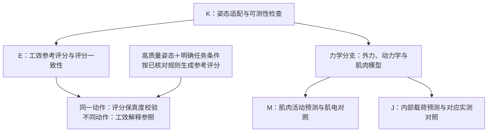

# Evalkit 工效参考评分与评分一致性

日期：2026-11-15

本说明补充金标验证设计中 E 模块的定位。E 的主要作用是把姿态与任务条件映射为既定 RULA／REBA 规则下的工效评分，并提供评分一致性校验和结果解释参照。它与肌电、植入物测力支持的生理活动和内部载荷验证具有不同的证据性质。

## E 模块的两种用途

| 用途 | 对照方法 | 能支持的结论 |
| --- | --- | --- |
| 评分一致性校验 | 对同一动作，用高质量观测生成参考评分，再与项目骨架经过 evalkit 得到的评分比较 | 骨架信息损失、姿态重建和分档过程对评分造成了多大影响 |
| 工效解释参照 | 用真人作业数据的评分及其分布，解释生成动作的评分水平 | 生成动作按同一套工效规则，与真人作业参照有哪些差异 |

第一种用途要求动作、时间和任务条件对应，可以评价分项误差、分档一致率、阈值跨越及风险占比偏差。第二种用途可以比较不同轨迹的评分分布，但应控制任务、负重、姿态覆盖和统计口径，不能把分布相似解释为某条轨迹已经得到验证。

例如，同一动作从完整观测得到参考分数 5，转换为缺少头胸信息的骨架后，evalkit 给出 3，可以检查信息损失是否导致风险低估。这评价的是对评分规则的忠实复现，不能证明 5 分对应某个确定的肌肉力或真实损伤概率。

## 确定性参考评分的前提

姿态对齐是必要输入，但不总能确定完整 RULA／REBA 分数。评分还涉及负重、肌肉使用或活动情况，REBA 还包含抓握耦合等因素。只有所需输入和评分约定足够明确时，才适合生成确定的参考分数。相关输入及方法定位见 [RULA 原始论文](https://pubmed.ncbi.nlm.nih.gov/15676903/) 和 [REBA 原始论文](https://pubmed.ncbi.nlm.nih.gov/10711982/)。

对于缺失或不确定的项目，应保留评分范围或“不确定／不可测”状态。优质光学数据仍存在标定和角度误差；靠近评分边界时，需要报告这些误差是否会导致分档变化。不能通过未声明的默认补值，把不完整观测变成确定性金标。

AndyData 的人工姿势类别和 EAWS 相关标签可约束姿态类别与对应分项，但并不是现成的完整 RULA／REBA 人工真值。构建参考评分时仍须补齐任务条件，并明确标签与评分分项的对应关系。

## 校验评分规则与校验输入误差

评分规则本身的实现，应使用已知输入、独立手算、原始评分表或独立实现核对，重点检查角度分界、附加项和查表组合。

完整观测与降级骨架可以使用同一套已经核对的评分代码。这样的配对实验主要隔离姿态输入与表示误差；由于两侧共享评分代码，它不能独立发现两侧共同存在的查表错误。

如果需要校准骨架中立位、解剖坐标或缺失处理策略，应在校准试次上确定，再用留出的试次评价评分一致性，避免为了匹配测试分数而调整参数。

## 与 evalkit 其他模块的关系

图中的 E 应标为“工效参考评分与评分一致性”。它是姿态处理之后的一条工效解释分支，与肌肉活动、内部载荷分支并行。

M 利用肌电检验模型预测的肌肉活动时序、模式和条件响应；J 在解剖位置、坐标和受力定义匹配的情况下，利用植入物等独立观测检验内部载荷。E 则检验规则评分的准确执行及其对姿态信息损失的敏感性，并解释动作的工效水平。

E 的参考评分不是 M／J 的实测载荷真值，E 分数较低也不保证肌肉力或关节载荷一定较低。各分支分别报告其证据、误差与适用范围，不汇总成无条件的“动作合理”结论。

## 对金标说明图的标注约定

- K：姿态处理与运动学误差校验。
- X：外力估计与动力学一致性检查。
- E：工效参考评分与评分一致性，包含规则实现核对、同动作评分保真度和跨动作解释参照。
- M：被测肌肉活动的观测一致性校验。
- J：对应解剖结构内部载荷的观测一致性校验。

上述模块定位沿用《金标数据、支撑条件与 OpenSim》汇报的七类数据来源口径；本说明细化其中 E 的证据性质，不把工效评分等同于肌肉力或关节载荷验证。
